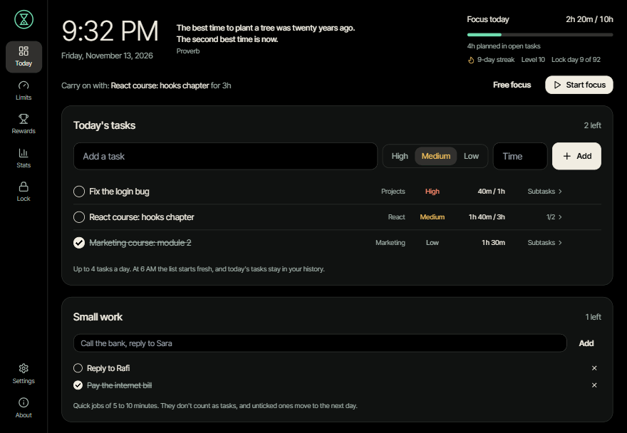
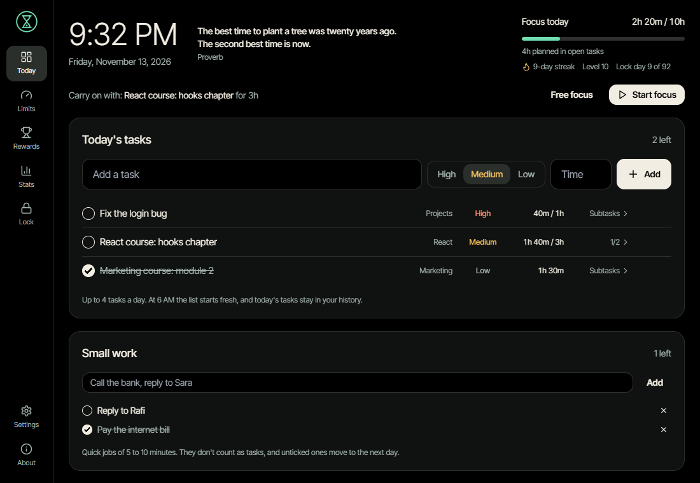
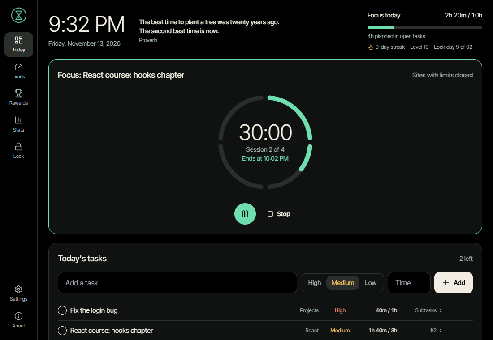
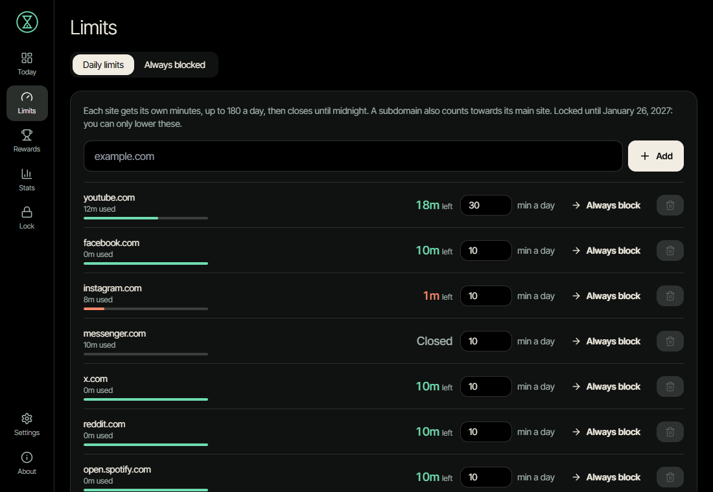
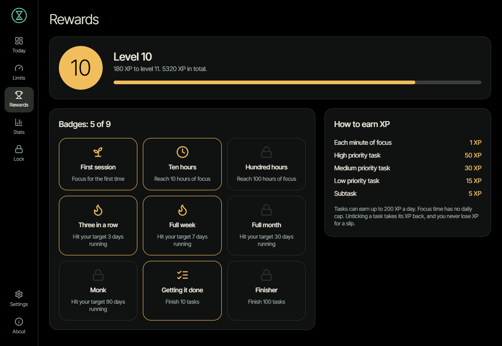
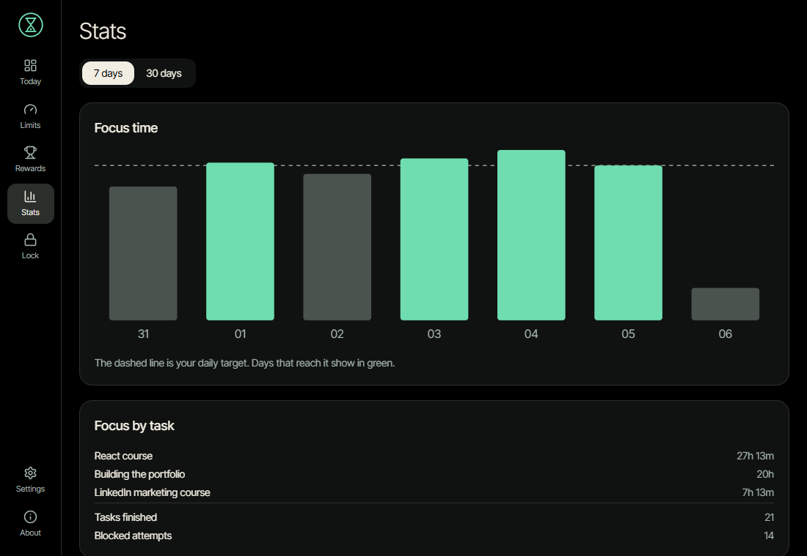
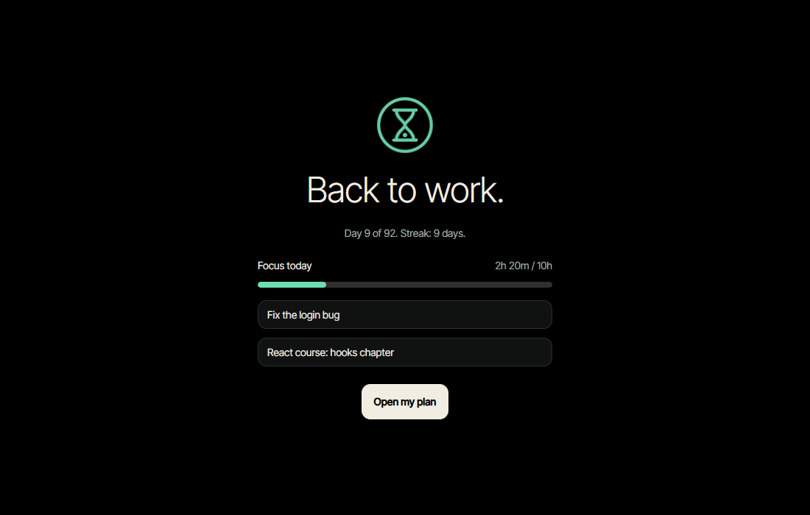
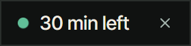

# Monk Mode Blocker

**A free, open source Windows app that keeps distracting sites closed while you study, and is hard to switch off on a bad day.**



Each distracting site gets a small daily allowance. When it runs out, the site closes until midnight in every browser and app. Plan your day as tasks with a priority and a time, run focus sessions, and earn XP as you go. A commitment lock means that until the date you choose, the rules can only get stricter.

## Features

- **A daily limit per site.** YouTube gets 30 minutes and other sites get 10 by default. You can set anything from 0 to 180 minutes. Time only counts while you're actually looking at the site.
- **Always blocked sites.** The worst ones, like TikTok, stay closed all day.
- **Shorts and Reels blocked.** YouTube Shorts, Instagram Reels and Facebook Watch stay closed even when you have time left. Normal videos still play.
- **Today's tasks.** Add a task with a priority and a total time, then break it into subtasks with their own times. The time you spend on each task shows against what you planned.
- **Focus sessions.** These are 50 minutes of focus and a 10 minute break by default. A chime plays at the end of each, and a small always-on-top timer shows the time left. Sites with limits are closed during focus.
- **XP, levels and badges.** You earn XP for minutes of focus and finished tasks. You never lose XP for a slip.
- **A commitment lock.** Pick an end date. Until then you can make your rules stricter, but not looser.
- **Stats and a streak** for each day you hit your focus target.

Desktop apps like Spotify and Discord are never blocked or closed.

## Screenshots

| Today                                                                            | Focus session                                                                         |
| -------------------------------------------------------------------------------- | ------------------------------------------------------------------------------------- |
|  |  |

| Limits                                                             | Rewards                                               |
| ------------------------------------------------------------------ | ----------------------------------------------------- |
|  |  |

| Stats                                                          | Block page                                                           |
| -------------------------------------------------------------- | -------------------------------------------------------------------- |
|  |  |

The small timer stays on top of your other windows while a session runs:



## Install

You need Windows 10 or 11 (64-bit) and Chrome, Edge or Brave.

1. **Get the installer.** Download it from the [Releases](https://github.com/Tokiosman80F/monk-mode/releases) page. Until a release is published, take it from the **installer** artifact of the latest [CI run](https://github.com/Tokiosman80F/monk-mode/actions), or [build it yourself](#build-from-source).
2. **Run it and approve the admin prompt.** This installs the background service, which does the blocking. `tiktok.com` is blocked from then on.
3. **Follow the setup wizard** that opens. It checks the service, helps you add the browser extension and shows your starting lists.

> Windows may warn about the installer, because it isn't code-signed yet. Some antivirus tools also flag apps that edit the hosts file. Windows Defender flagged it once in testing as `Trojan:Win32/Bearfoos.B!ml`, which is a machine-learning guess. Only install a copy you built or got from this repository.

### Add the browser extension

Do this in **every** browser you use. If a browser runs without the extension, its sites with limits are blocked after 30 seconds, because the app can't measure your time there.

1. Open `chrome://extensions` (`edge://extensions` in Edge, `brave://extensions` in Brave).
2. Turn on **Developer mode**.
3. Choose **Load unpacked**, and pick `C:\Program Files\Monk Mode\extension`. The setup wizard has a button that opens this folder.
4. In the extension's details, turn on **Allow in Incognito**.

Use the installed folder, not the zip from CI. The installed copy holds the token that lets the extension talk to the service.

## How to use it

### Set your limits

Open **Limits**. Each site shows how much time it has left today. Change the minutes, add a site, or move a site to **Always blocked**. A subdomain counts towards its main site, so `music.youtube.com` uses YouTube's time.

### Plan your day

On **Today**, type a task, pick **High**, **Medium** or **Low**, and enter the total time, like `3h`, `45m` or `1h 30m`. The new task opens so you can add subtasks, each with its own time. The most important tasks go to the top, and unfinished ones carry over to tomorrow.

### Focus

Click **Start focus** to work on the next task, or the play button on any task. While the session runs:

- every site with a limit is closed
- the small timer in the corner shows the time left, and you can drag it anywhere
- the screen shows when it ends, like `Ends at 10:50 AM`

When it ends, you hear a chime and the break starts. After the break, **Start focus** carries on with the same task.

### Earn XP

| What you do                                | XP           |
| ------------------------------------------ | ------------ |
| Each minute of focus                       | 1            |
| Finish a high, medium or low priority task | 50, 30 or 15 |
| Finish a subtask                           | 5            |

Tasks can earn up to 200 XP a day, so adding and ticking off made-up tasks can't buy levels. Focus time has no cap. **Rewards** shows your level and badges.

### Lock it in

Open **Lock**, pick a length (1 week, 1 month, 3 months or a date), and type `I commit to monk mode`. **There's no undo**, so try a short lock first.

| While locked, you can         | You can't                                     |
| ----------------------------- | --------------------------------------------- |
| Add sites to either list      | Remove any site                               |
| Move a site to always blocked | Give an always blocked site a limit           |
| Lower a site's daily limit    | Raise a site's daily limit                    |
|                               | Turn off the Shorts and Reels blocker         |
|                               | Shorten or remove the lock                    |
|                               | Stop the service, uninstall or update the app |

## How it works

```
        Browser extension                     Monk Mode app (tray)
   time on the active tab, URL rules      tasks, focus, limits, timer
                 │                                     │
            WebSocket                             named pipe
                 └───────────────┐   ┌─────────────────┘
                                 ▼   ▼
                    Monk Mode service (Windows Service)
               rules, limits, lock, SQLite, hosts file every 5 s
```

- **The service is the only source of truth.** It runs as a Windows Service, so closing the app changes nothing. It checks and rewrites its block in the hosts file every 5 seconds, which works in every browser and app.
- **The extension measures time.** It reports the active tab, so a site only uses time while you're looking at it. It also blocks things the hosts file can't, like `youtube.com/shorts`.
- **The app is just a client.** It sends requests, and the service checks each one. For example, it refuses to raise a limit during a lock.
- **The lock is kept twice.** The service keeps the end date in its database and as a signed copy in the registry, so deleting one doesn't unlock. Turning the clock back doesn't shorten a lock either.

## Limitations

The goal is to make giving up slow and annoying, not impossible. An admin user can still get around it:

- **Safe Mode or a Windows reinstall** gets past the service.
- **Moving the system clock ahead** ends a lock early and refills the limits. Only moving it back is protected.
- **Other browsers**, such as Firefox, aren't monitored. The hosts file still blocks sites once their limits are used up, but time spent there isn't counted.
- **Secure DNS (DNS over HTTPS)** can skip the hosts file in a browser. The extension still blocks the site there.
- **A muted video** with no mouse or keyboard input stops counting after 2 minutes, because the browser reports you as idle.
- **Updates** can't be installed during a lock. The installer refuses and changes nothing.

## Build from source

You need Node 20 or later, Rust with the MSVC toolchain, and the Visual Studio C++ Build Tools.

```bash
npm install
```

```bash
npm run build -w app
```

`cargo` needs `app/dist` to exist, so run that build once first. Then build the installer, which ends up in `target/release/bundle/nsis/`:

```bash
npm run tauri build -w app
```

### Develop

To try the service without touching the real hosts file or data, set `MONK_HOSTS_PATH` and `MONK_DATA_DIR` to temporary paths, then run:

```bash
cargo run -p monk-service -- console
```

In another terminal, start the app:

```bash
npm run tauri dev -w app
```

After changing a message or model in `crates/core`, run `npm run gen:types`.

```
crates/core       Rules engine: limits, lock rules, tasks, XP. Pure Rust, no OS calls.
crates/platform   Windows: hosts file, browser detection, registry, user-session launch.
crates/service    monk-service.exe: the main loop, SQLite, WebSocket and named pipe servers.
app/              Tauri 2 app: React, TypeScript and DaisyUI, plus the tray and timer.
extension/        Manifest V3 extension: active-tab timer, URL blocking, block page.
installer/        NSIS hooks that install the service and extension.
docs/             Manual tests and screenshots.
```

## Contributing

Issues and pull requests are welcome. Before opening a pull request, run these and make sure they pass:

```bash
npm run lint
```

```bash
npm run test
```

```bash
cargo clippy --workspace --all-targets -- -D warnings
```

```bash
cargo test --workspace
```

Automated tests can't cover a real service install or real browsers, so [docs/manual-tests.md](docs/manual-tests.md) lists those checks.

## License

[MIT](LICENSE)
