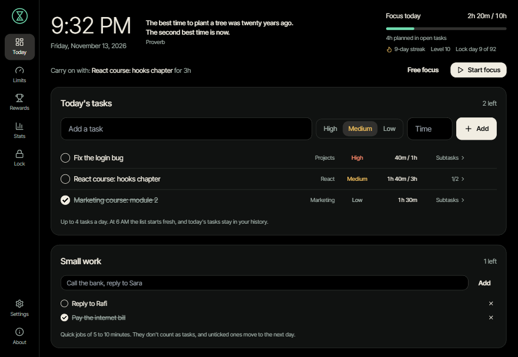
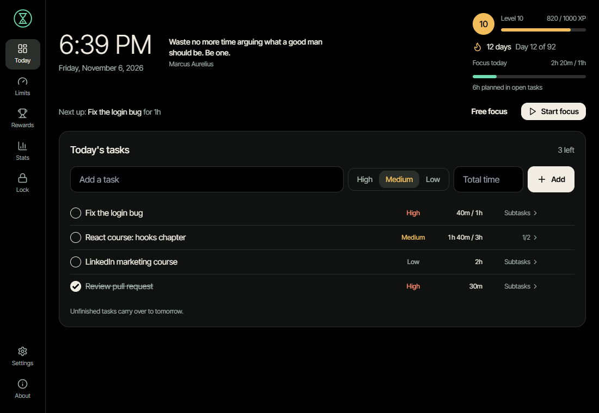
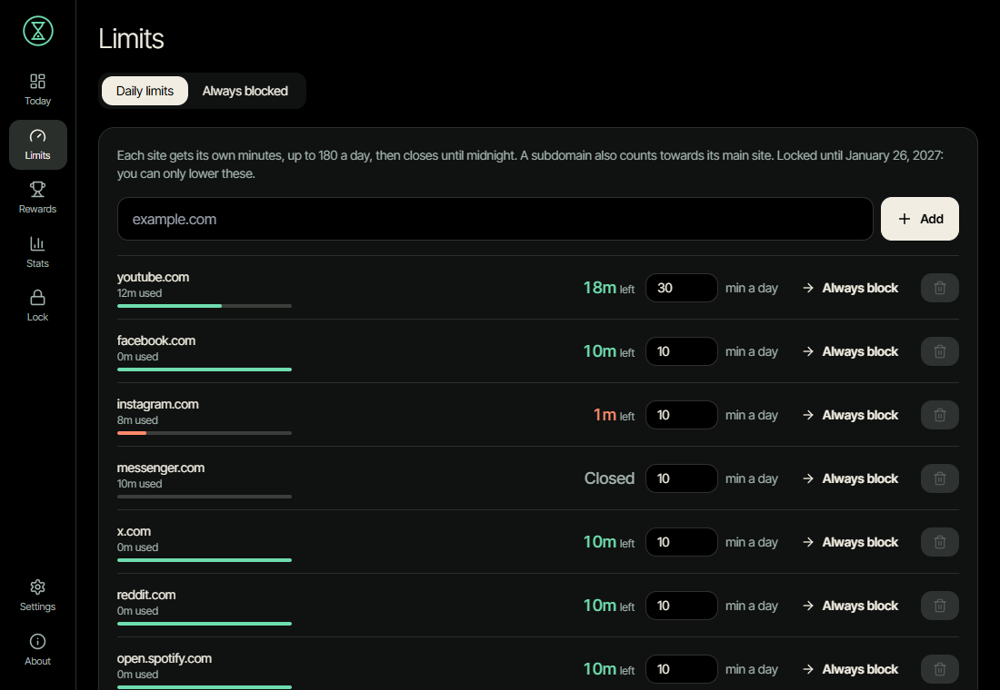
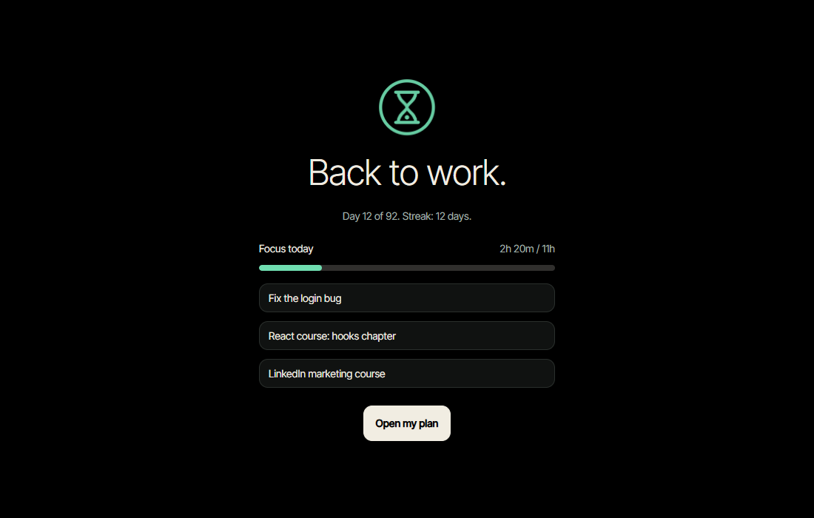
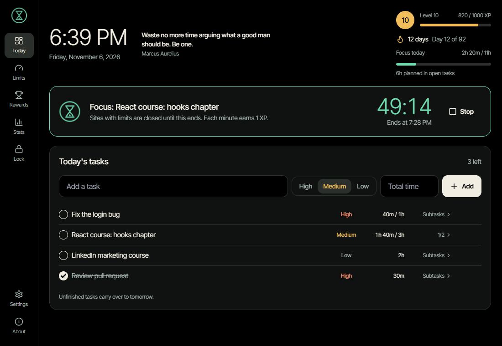
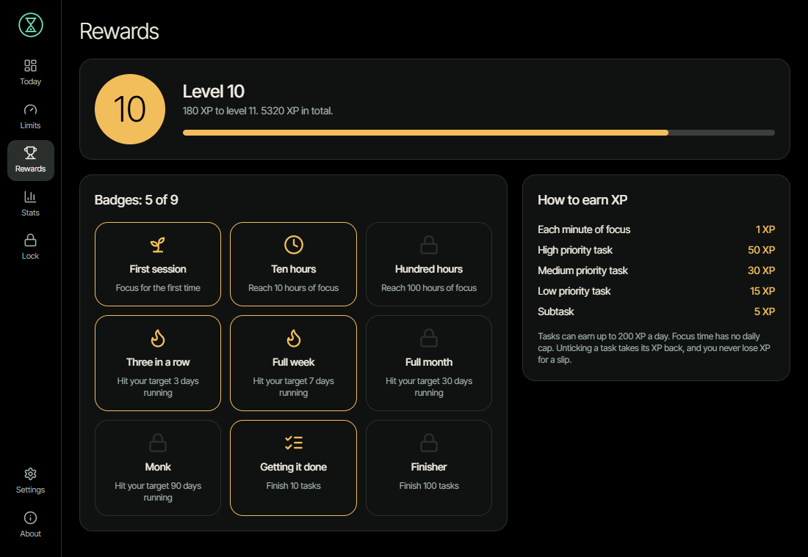

# I built a free website blocker I can't switch off on a bad day



For the next three months I'm doing "monk mode": twelve hours of study a day. Three hours of React, six hours building real projects, two hours of a marketing course, and one hour of slack for everything else.

The plan was simple. The hard part was the ten seconds between finishing a chapter and finding myself forty minutes deep in YouTube Shorts.

This post is about the tool I built to fix that: **Monk Mode Blocker**, a free and open source app for Windows.

## Where the idea came from

On my phone the problem was already solved. I use **Kahf Guard**, which does three things well:

1. It filters sites at the DNS level, so a blocked site is blocked in every app.
2. It blocks Reels and Shorts inside apps, while leaving the rest usable.
3. It has strict uninstall protection, so I can't remove it in a weak moment.

The third one is the important part. Every blocker works on a good day. What matters is whether it still works at 11 PM when you've talked yourself into "just ten minutes".

On my laptop, nothing free did all three. Browser extensions can be turned off in two clicks. Good desktop blockers mostly cost money, and the best known one, Cold Turkey, charges for the features I needed. So I wrote down exactly what I wanted, copied the ideas that make Kahf Guard work, and built it for the desktop:

| On the phone (Kahf Guard)        | On the desktop (Monk Mode Blocker)                                           |
| -------------------------------- | ---------------------------------------------------------------------------- |
| A DNS filter answers "blocked"   | The **hosts file** points blocked sites nowhere, in every browser and app    |
| Reels and Shorts blocked in apps | A **browser extension** blocks `/shorts` and `/reels` pages                  |
| Screen time limits               | The extension measures **real time on each site**                            |
| Uninstall protection             | A **commitment lock** and a **Windows Service** that won't stop or uninstall |

## Who it's for

Monk Mode Blocker is for you if:

- **You're studying or building something for weeks at a time** and want the next three months to look different from the last three.
- **You don't want to quit the internet.** You need YouTube for tutorials, but not the recommendations after the tutorial.
- **You know you'll try to undo it.** If your problem is the moment you decide to turn the blocker off, you need one that says no.
- **You want something free that you can inspect.** It's MIT licensed, and every rule it enforces is in the code.

It's probably not for you if you're on a Mac or Linux (it's Windows only for now), or if you want blocking that syncs across your phone and laptop.

## What it does



**A daily limit for each site.** YouTube gets 30 minutes a day, because I learn from it. Facebook, Instagram and Messenger get 10 minutes each. Time only counts while the site is the active tab in front of you, not while it sits in the background. When a site runs out, it's closed until midnight, everywhere.



**Always blocked sites.** TikTok is blocked from the minute you install. You can add more.

**Shorts and Reels are always closed.** Even with YouTube time left, `youtube.com/shorts` sends you to a block page, and the Shorts shelves are hidden on the home page. Normal videos still play.



**Today's tasks.** Each task gets a priority (high, medium or low) and a total time, like `3h`. Then you split it into subtasks with their own times. As you work, each task shows the time spent against the time you planned, like `1h 40m / 3h`.

**Focus sessions.** Click **Start focus** and every site with a limit closes for 50 minutes. The app shows when the session ends, a small timer stays in the corner of your screen, and a chime plays when it's over. After the break, **Start focus** carries on with the same task.



**XP, levels and badges.** You get 1 XP for each minute of focus and up to 50 for a finished task. You never lose XP for a slip. The point is to reward the work, not to punish you for being human.



**A commitment lock.** You pick an end date and type `I commit to monk mode`. Until that date you can only make the rules stricter. You can add sites and lower limits, but you can't remove a site, raise a limit, stop the service or uninstall the app.

## How it compares

There are good tools already. Here's how they differ from Monk Mode Blocker:

| Tool                    | What it is                          | Blocks outside the browser  | Hard to undo                                | Price                        |
| ----------------------- | ----------------------------------- | --------------------------- | ------------------------------------------- | ---------------------------- |
| **Monk Mode Blocker**   | Windows app, service and extension  | Yes, through the hosts file | Yes: a lock, plus a service that won't stop | Free, open source            |
| **Cold Turkey Blocker** | Desktop blocker for Windows and Mac | Yes, and it can block apps  | Yes, in the paid version                    | Free basic version, paid Pro |
| **Freedom**             | Blocker that syncs across devices   | Yes                         | A "locked mode"                             | Paid subscription            |
| **LeechBlock NG**       | Browser extension                   | No                          | Partly: you can delay changes               | Free, open source            |
| **StayFocusd**          | Chrome extension with time limits   | No                          | Partly                                      | Free                         |
| **Forest**              | Focus timer where a tree grows      | No, it's a timer            | No                                          | Paid apps, free extension    |

Monk Mode Blocker sits between them. It has the stubbornness of Cold Turkey and the price of an extension, plus three things I couldn't find together anywhere else:

- a separate limit for each site
- Shorts and Reels blocked while normal videos keep working
- a task list with time planned and time spent

## How it actually works

The app is three programs that each do one job:

```
        Browser extension                     Monk Mode app (tray)
   time on the active tab, URL rules      tasks, focus, limits, timer
                 │                                     │
            WebSocket                             named pipe
                 └───────────────┐   ┌─────────────────┘
                                 ▼   ▼
                    Monk Mode service (Windows Service)
               rules, limits, lock, SQLite, hosts file every 5 s
```

**The service is the boss.** It's a Windows Service written in Rust, and it runs as the system account. It holds every rule, counts every second, and keeps everything in a small SQLite database. Every five seconds it checks the hosts file and puts its block back if anything changed. If you edit the hosts file by hand, your change lasts about five seconds.

**The hosts file does the blocking.** Windows checks the hosts file before it looks up any site. Pointing `youtube.com` at `0.0.0.0` makes it unreachable in Chrome, Edge, Firefox and every other app, with nothing to install in each one. It works at the domain level, so it can't tell `youtube.com/watch` from `youtube.com/shorts`.

**The extension handles what the hosts file can't.** It reports which tab is active, so time only counts while you're looking at a site. It also redirects pages like `/shorts` and `/reels` to the block page. If a browser runs for more than 30 seconds without the extension, the service assumes you're trying to dodge it and closes your sites with limits in that browser.

**The app is just a window onto the service.** It's built with Tauri, so it's a small Rust program with a React interface rather than a full Electron browser. It sends requests to the service through a named pipe, and the service checks every one. When the app asks to raise YouTube's limit during a lock, the service refuses, no matter what the app says. Closing the app changes nothing, and if you kill it, the service starts it again.

**The lock is kept twice.** The lock's end date is stored in the database and as a signed copy in the Windows registry. Deleting one copy doesn't help, because the service trusts the later of the two valid dates and repairs the other. It also remembers the latest time it has seen, so turning the clock back doesn't shorten a lock.

**It's honest about its limits.** An admin who boots into Safe Mode or reinstalls Windows can get around it. So can someone who moves the clock _forward_. The goal was never to make quitting impossible, just slow and annoying enough that the urge passes first.

## How to install it

You need Windows 10 or 11 (64-bit) and Chrome, Edge or Brave.

1. **Download the installer** from the [project's GitHub page](https://github.com/Tokiosman80F/monk-mode), or build it yourself from source.
2. **Run it and approve the admin prompt.** This installs the background service, and TikTok is blocked from that moment.
3. **Follow the setup wizard.** It checks the service and shows you your starting limits.
4. **Add the extension to every browser you use:**
   1. Open `chrome://extensions` (or `edge://extensions` in Edge).
   2. Turn on **Developer mode**.
   3. Click **Load unpacked**, and choose `C:\Program Files\Monk Mode\extension`.
   4. Turn on **Allow in Incognito**.
5. **Set your limits** on the **Limits** screen, add today's tasks, and press **Start focus**.

When you're ready, start a short lock first, maybe a week. **There's no undo**, which is the point.

> Windows may warn about the installer because it isn't code-signed yet, and some antivirus tools are wary of anything that edits the hosts file. Only install a copy you built or downloaded from the project's own GitHub page.

## What I learned building it

- **Write down the rules before writing code.** The whole app grew from a one-page spec of what the lock allows and forbids. Every one of those rules has a test.
- **The hardest bugs were Windows bugs, not logic bugs.** One example is the service ignoring a stop request during a lock. That needed a different approach from the one the documentation suggests, because the library ends the service on any stop request, even a refused one.
- **Keep it simple.** I added an Eisenhower Matrix for sorting tasks, used it for a day, and took it out again. A list sorted by priority, with times, was all I needed.
- **Reward the work, not the absence of failure.** XP only goes up. A bad hour costs you nothing except the XP you didn't earn.

## Try it, or help build it

Monk Mode Blocker is free and MIT licensed. The code, the full design document and the list of manual tests are all on [GitHub](https://github.com/Tokiosman80F/monk-mode). Issues and pull requests are welcome, especially from anyone who wants to bring it to macOS.

Day 12 of 92. Back to work.
